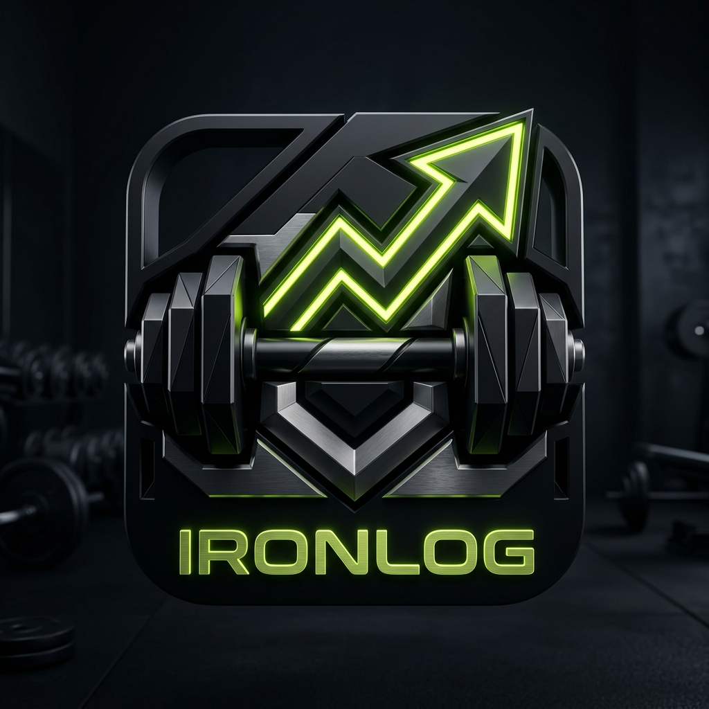

<div align="center">

# تطبيق ومنظومة IRONLOG | آيرون لوج



### المنظومة الرياضية الذكية لتتبع تمارين كمال الأجسام واللياقة البدنية
**Smart Athletic Workout Tracking & Bodybuilding Fitness Management Platform**

<br/>

[](https://flutter.dev)
[](https://dart.dev)
[](https://laravel.com)
[](https://php.net)
[](https://mysql.com)
[](https://android.com)

</div>

---

## 📌 نبذة عن المشروع (Project Overview)

منظومة وتطبيق **IRONLOG (آيرون لوج)** هي منصة رياضية متكاملة مصممة خصيصاً للاعبي كمال الأجسام، اللياقة البدنية (Fitness)، والرياضيين؛ لتدوين ومتابعة التمارين اليومية، الجولات، والأوزان بكل دقة واحترافية.

يجمع المشروع بين **تطبيق موبايل حديث مبني بفلاتر (Flutter)** بواجهات عصرية مخصصة للرياضيين (Neon Athletic Theme) تدعم الوضعين الداكن والتفاعلي مع دعم كامل للغتين العربية والإنجليزية، وبين **باك إند قوي مبني بإطار عمل Laravel 11** يوفر واجهات برمجة تطبيقات RESTful APIs متقدمة لمزامنة الجداول، التمارين، والبيانات الرياضية لحظياً عبر السيرفر السحابي.

يتضمن التطبيق دعماً حصرياً لمصادقة **بصمة الإصبع الحقيقية لنظام أندرويد (Native Biometric Authentication)** لتسجيل الدخول السريع واستعادة الحساب، مع وضع العمل دون اتصال (Offline-First) لمواصلة التمرين حتى عند انقطاع الإنترنت.

---

## 🏛️ هيكلية النظام والمشاريع (System Architecture)

تم تنظيم المشروع بهيكلية برمجية متناسقة تفصل بين تطبيق الهاتف المحمول وخوادم الباك إند:

```
iron-man/
│
├── frontend/                              # تطبيق الموبايل والويب (Flutter / Dart)
│   ├── lib/
│   │   ├── models/                        # نماذج البيانات الرياضية (Workout, Exercise, ExerciseSet)
│   │   ├── providers/                     # إدارة الحالة والمزامنة (WorkoutProvider)
│   │   ├── services/                      # الخدمات الأساسية ومستشعر البصمة (BiometricService)
│   │   ├── theme/                         # ثيم النظام الموحد والألوان الرياضية النيون (AppTheme)
│   │   ├── screens/                       # شاشات وواجهات المستخدم:
│   │   │   ├── auth_screen.dart           # شاشة تسجيل الدخول وإنشاء الحساب والمصادقة بالبصمة
│   │   │   ├── home_screen.dart           # الشاشة الرئيسية، ملخص الأيام، وسجل الأداء
│   │   │   ├── exercises_screen.dart      # جدول وتفاصيل التمارين والمجموعات والجولات
│   │   │   ├── active_workout_screen.dart # شاشة التمرين الجاري وتوقيت الراحة
│   │   │   ├── history_screen.dart        # السجل التاريخي للتمارين والأوزان السابقة
│   │   │   ├── profile_screen.dart        # الملف الشخصي وإعدادات الحساب والبصمة
│   │   │   └── statistics_screen.dart     # الإحصائيات البيانية وتطور الأوزان
│   │   └── widgets/                       # المكونات والعناصر القابلة لإعادة الاستخدام
│   ├── android/                           # إعدادات أندرويد الأصلية ومستشعر البصمة (Local Auth)
│   └── pubspec.yaml                       # حزم ومكتبات فلاتر
│
└── backend/                               # لوحة التحكم وخوادم الـ API (Laravel 11 / PHP 8.3)
    ├── app/
    │   ├── Http/Controllers/              # وحدات التحكم (AuthController, WorkoutController...)
    │   └── Models/                        # نماذج قواعد البيانات (User, Workout, Exercise, Set)
    ├── routes/
    │   └── api.php                        # مسارات الـ RESTful API (المصادقة، المزامنة، التمارين)
    ├── database/
    │   ├── migrations/                    # هيكل وتداول جداول البيانات
    │   └── seeders/                       # بيانات التمارين الافتراضية
    └── composer.json                      # حزم ومكتبات خادم لارافيل
```

---

## ✨ أبرز المزايا التقنية (Key Technical Highlights)

1. **حماية ومصادقة البصمة الحقيقية لأندرويد (Native Android Biometric Security):**
   - ربط كامل مع مستشعر البصمة الحقيقي للهاتف عبر `BiometricPrompt` لتسجيل الدخول السريع بلمسة واحدة دون كتابة كلمات المرور.
   - إمكانية إعادة تعيين كلمة المرور فورياً عبر بصمة الإصبع الفيزيائية المعتمدة في الهاتف.

2. **التسجيل الذكي للجولات والأوزان (Set & Rep Tracking Engine):**
   - تسجيل فوري للأوزان (kg)، التكرارات (Reps)، وحالة الإكمال (Done) لكل جولة داخل التمرين.
   - حساب إجمالي الحجم التدريبي (Volume Load) تلقائياً لكل عضلة وتمرين.

3. **ساعة الإيقاف ومؤقت فترات الراحة (Rest Timer & Active Workout HUD):**
   - عداد ذكي لفترات الراحة بين الجولات مع تنبيهات صوتية واهتزاز فور انتهاء وقت الراحة للاستعداد للجولة التالية.

4. **تكامل كامل مع السيرفر السحابي (Cloud Sync & RESTful API):**
   - مزامنة البيانات تلقائياً مع خادم Laravel 11 عبر مصادقة التوكن الآمنة (Bearer Token).
   - تخزين محلي هجين يدعم العمل بدون اتصال (Offline-First) والمزامنة فور استعادة الإنترنت.

5. **تصميم رياضي احترافي عالي الجمالية (Dark Athletic Neon UI):**
   - واجهة داكنة مريحة للعين داخل صالة الألعاب الرياضية مدعومة بلمسات نيون فسفورية (Volt Neon & Cyan).
   - دعم كامل ومتكامل للغتين العربية والإنجليزية مع اتجاهات RTL/LTR مرنة وسريعة التبديل.

6. **إحصائيات التقدم والرسوم البيانية (Progress Analytics):**
   - متابعة مؤشرات القوة وتطور الأوزان عبر الزمن مع استعراض الأيام التدريبية النشطة في الأسبوع والشهر.

---

## 🛠️ حزمة التقنيات المستخدمة (Tech Stack)

- **Mobile Application:** Flutter 3.x, Dart 3.x, Provider State Management, Local Authentication (Biometric Security), Shared Preferences, HTTP Client.
- **Backend & APIs:** Laravel 11, PHP 8.3, RESTful Architecture, JSON API, Token Authentication.
- **Database:** MySQL 8.0 / SQLite support.
- **UI & UX:** Modern Athletic Dark & Neon Palette, Responsive Layouts, Bi-directional Localization (AR/EN).

---

## 🚀 التشغيل والإعداد المحلي (Getting Started)

### 1. إعداد تطبيق الموبايل (Flutter App Setup)

1. انتقل إلى مجلد تطبيق الفلاتر:
```bash
cd frontend
```

2. قم بتثبيت الحزم والمكتبات:
```bash
flutter pub get
```

3. تشغيل التطبيق على الهاتف أو المحاكي:
```bash
flutter run
```

4. لبناء ملف التثبيت النهائي (Release APK):
```bash
flutter build apk --release
```

---

### 2. إعداد الباك إند (Laravel Backend Setup)

1. انتقل إلى مجلد الباك إند:
```bash
cd backend
```

2. أنشئ ملف البيئة `.env` من القالب:
```bash
cp .env.example .env
```

3. ثبّت حزم وملفات الـ Composer:
```bash
composer install
```

4. قم بتوليد مفتاح التطبيق وتشغيل قواعد البيانات:
```bash
php artisan key:generate
php artisan migrate
```

5. تشغيل السيرفر المحلي:
```bash
php artisan serve
```

---

## 🔒 الأمان وحماية البيانات (Security & Privacy)

- **تشفير كلمات المرور والتوكنات:** يتم تشفير كلمات المرور باستخدام خوارزمية `Bcrypt`، مع تأمين الاتصالات عبر بروتوكولات RESTful مشفرة.
- **عزل المفاتيح السرية:** استبعاد ملفات الإعدادات الحساسة (`.env`) وملفات قواعد البيانات والملفات المؤقتة تماماً عبر ملف `.gitignore` الشامل لضمان سلامة الكود العام.
- **حماية البصمة البيومترية:** معالجة بصمات الأصابع محلياً على مستوى أجهزة الهواتف المشفرة (Hardware-backed Keystore) دون إرسال أي بيانات بيومترية عبر الشبكة.

---

## 👨‍💻 المطور (Author & Contact)

- **الاسم:** محمد سليمان علي (Mohamed Suliman Ali)
- **GitHub:** [@mohamed-suliman2004](https://github.com/mohamed-suliman2004)
- **المشروع:** تطبيق ومنظومة آيرون لوج (IRONLOG Gym & Fitness Platform)
